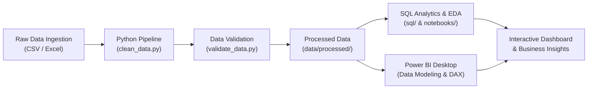

# Sales Dashboard Analysis

[](LICENSE)
[](https://www.python.org/)
[](https://powerbi.microsoft.com/)
[]()

> An end-to-end sales analytics solution transforming raw transaction records into actionable business intelligence through automated Python data engineering, advanced SQL analytics, and interactive Power BI executive dashboards.

---

## 1. Project Overview & Business Problem

Modern retail and commercial businesses generate massive volumes of daily transactional data across diverse product categories, customer segments, and geographic regions. However, leadership and operational stakeholders frequently struggle to extract timely, actionable insights due to:

- Fragmented, uncleaned transactional records containing missing values, inconsistent formats, and duplicates.
- Lack of consolidated KPI tracking for revenue velocity, profitability margins, and customer retention.
- Inability to quickly detect underperforming product lines or regional bottlenecks through static spreadsheets.

### Project Objectives
1. **Automate Data Hygiene**: Build a reliable, reproducible Python pipeline to ingest, clean, deduplicate, and validate raw transactional records.
2. **Deliver Relational SQL Analytics**: Author modular SQL queries to compute core business KPIs, running totals, and Month-over-Month (MoM) growth metrics.
3. **Build an Executive Power BI Dashboard**: Construct a multi-page interactive dashboard featuring dynamic KPI cards, time-series forecasting, category breakdown, and geographic heatmaps.
4. **Formulate Data-Driven Recommendations**: Translate statistical insights into clear business actions to optimize product margins and sales channel efficiency.

---

## 2. Planned Tools & Technologies

| Layer | Tools & Technologies | Purpose |
| :--- | :--- | :--- |
| **Data Engineering** | Python 3.10+, Pandas, NumPy | Data cleaning, schema standardization, and pipeline automation (`src/`) |
| **Data Quality & Testing** | Pytest, Custom Validation Rules | Automated assertion checks and data integrity checks (`src/validate_data.py`) |
| **Exploratory Analysis** | Jupyter Notebooks, Seaborn, Matplotlib | Hypothesis testing, distribution analysis, and visual EDA (`notebooks/`) |
| **Relational Analytics** | SQL (PostgreSQL / SQLite / BigQuery syntax) | Business queries, window functions, and CTE aggregations (`sql/`) |
| **Data Modeling & BI** | Power BI Desktop, DAX, Power Query | Star-schema data modeling, calculated measures, and interactive reporting (`powerbi/`) |
| **Version Control & CI** | Git, GitHub | Distributed collaboration, feature branching, and pull request reviews |

---

## 3. Planned End-to-End Workflow



1. **Data Collection & Ingestion**: Source raw transaction datasets into `data/raw/`.
2. **Data Cleaning & Standardization**: Python pipeline standardizes headers, handles nulls/duplicates, and normalizes types into `data/processed/`.
3. **Validation & Quality Assurance**: Verification script asserts schema conformance and value boundaries.
4. **Relational Analysis**: Run analytical SQL queries to evaluate revenue trends, customer lifetime value, and profitability.
5. **Interactive Visualization**: Import processed data into Power BI Desktop, establish star schema relationships, create DAX measures, and publish dashboard reports.
6. **Insight Synthesis**: Document findings, executive takeaways, and operational recommendations.

---

## 4. Repository Structure

```text
sales-dashboard-analysis/
│
├── data/
│   ├── raw/                  # Immutable original datasets (excluded from Git)
│   │   └── .gitkeep
│   └── processed/            # Sanitized, model-ready datasets (excluded from Git)
│       └── .gitkeep
│
├── notebooks/                # Jupyter notebooks for EDA and prototyping
│   └── .gitkeep
│
├── src/                      # Modular production Python code
│   ├── __init__.py           # Package marker
│   ├── clean_data.py         # Data cleaning & preprocessing pipeline
│   └── validate_data.py      # Automated data quality & integrity checks
│
├── sql/                      # Relational analysis queries and KPI calculations
│   └── sales_analysis.sql
│
├── powerbi/                  # Power BI Desktop files (.pbix / .pbip)
│   └── .gitkeep
│
├── screenshots/              # High-resolution dashboard previews for presentation
│   └── .gitkeep
│
├── outputs/                  # Exported summary tables, charts, and metrics
│   └── .gitkeep
│
├── tests/                    # Unit tests for transformation functions
│   └── .gitkeep
│
├── .gitignore                # Windows, Python, and Power BI ignore rules
├── CONTRIBUTING.md           # Team branching strategy, PR rules, and Git standards
├── LICENSE                   # MIT License
├── README.md                 # Project documentation and roadmap
└── requirements.txt          # Python dependencies
```

---

## 5. Team Roles & Responsibilities

This project is developed collaboratively over a 7-day development cycle by a team of three:

| Member | Primary Focus | Key Responsibilities |
| :--- | :--- | :--- |
| **[Team Member 1 Name]** | Data Engineering Lead | Raw data ingestion, preprocessing scripts (`clean_data.py`), validation rules (`validate_data.py`), pipeline documentation. |
| **[Team Member 2 Name]** | Data Analysis Lead | Exploratory Data Analysis, statistical queries (`sales_analysis.sql`), MoM metrics, customer segmentation. |
| **[Team Member 3 Name]** | Data Visualization Lead | Power BI data modeling, DAX KPI measure calculation, interactive visuals, dashboard UX, screenshots, final presentation. |

> *Note: All members participate in peer code reviews, collaborative documentation, and end-to-end testing.*

---

## 6. Setup Instructions (Windows)

Follow these steps to set up the local development environment on Windows:

### 1. Clone the Repository
Open PowerShell or Command Prompt:
```bash
git clone https://github.com/samoltylundy226/Sales_Dashboard_Analysis.git
cd Sales_Dashboard_Analysis
```

### 2. Set Up a Python Virtual Environment

**In PowerShell:**
```powershell
# Create virtual environment
python -m venv venv

# Activate virtual environment
.\venv\Scripts\Activate.ps1
```
*(If PowerShell displays an execution policy error, run `Set-ExecutionPolicy -ExecutionPolicy RemoteSigned -Scope CurrentUser` once).*

**In Windows Command Prompt (cmd.exe):**
```cmd
python -m venv venv
venv\Scripts\activate.bat
```

### 3. Install Python Dependencies
```bash
python -m pip install --upgrade pip
pip install -r requirements.txt
```

### 4. Power BI Desktop Requirement
Ensure **Power BI Desktop** is installed (available free from the Microsoft Store or [Microsoft Power BI Download](https://powerbi.microsoft.com/desktop/)).

---

## 7. Project Status & 7-Day Roadmap

- [x] **Day 1: Project Setup & Repository Initialization**
  - [x] Configure repository architecture, `.gitignore`, and licensing.
  - [x] Set up collaborative branching strategy in `CONTRIBUTING.md`.
  - [x] Author starter templates for data cleaning, validation, and SQL queries.
  - [x] Connect local repository to GitHub.
- [ ] **Day 2: Dataset Selection & Ingestion**
  - [ ] Finalize target business dataset and place into `data/raw/`.
  - [ ] Document data dictionary and schema specifications.
- [ ] **Day 3: Data Cleaning & Validation Pipeline**
  - [ ] Complete `src/clean_data.py` with domain-specific cleaning logic.
  - [ ] Execute automated assertions in `src/validate_data.py`.
- [ ] **Day 4: Exploratory Data Analysis (EDA) & SQL Queries**
  - [ ] Conduct EDA in `notebooks/01_exploratory_data_analysis.ipynb`.
  - [ ] Finalize analytical queries in `sql/sales_analysis.sql`.
- [ ] **Day 5: Power BI Data Modeling & DAX Measures**
  - [ ] Build star-schema model with date dimension table in Power BI Desktop.
  - [ ] Create core DAX measures (Total Revenue, Profit Margin %, MoM Growth).
- [ ] **Day 6: Interactive Dashboard Design & Visual Polish**
  - [ ] Design Executive Summary, Product Performance, and Regional Breakdown pages.
  - [ ] Configure dynamic slicers, drill-throughs, and tooltips.
- [ ] **Day 7: Documentation, Presentation, and Final Release**
  - [ ] Export dashboard screenshots to `screenshots/`.
  - [ ] Finalize business findings and recommendations in `README.md`.
  - [ ] Tag production release v1.0.0.

---

## 8. Dashboard Previews & Key Findings

> *This section will be updated during Days 6–7 with high-resolution screenshots and synthesized business insights upon dashboard completion.*

### Dashboard Previews (Placeholders)

| Executive Summary | Regional & Product Analysis |
| :---: | :---: |
| *(Screenshot to be added: `screenshots/dashboard_overview.png`)* | *(Screenshot to be added: `screenshots/dashboard_details.png`)* |

### Key Business Insights (To Be Completed)
- **Top Revenue Drivers**: *(To be populated upon analysis completion)*
- **Profitability Bottlenecks**: *(To be populated upon analysis completion)*
- **Regional Opportunities**: *(To be populated upon analysis completion)*
- **Actionable Recommendations**: *(To be populated upon analysis completion)*

---

## 9. License

This project is licensed under the MIT License - see the [LICENSE](LICENSE) file for details.
Dataset licensing terms apply independently to third-party data sources.
